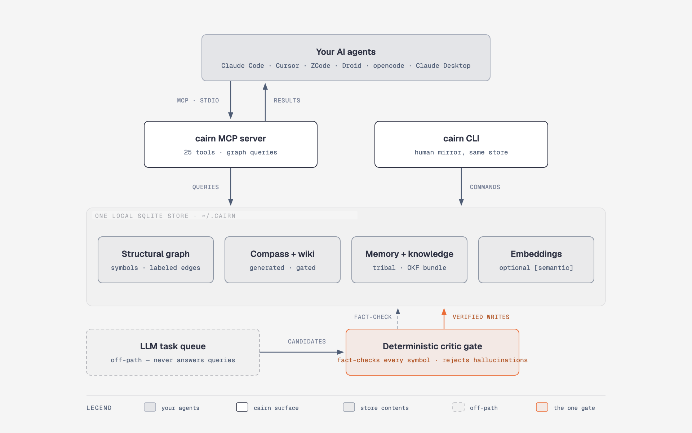

<div align="center">
  
</div>

# cairn

> **Verifiable codebase memory for AI agents** — a structural graph + compass + wiki + tribal memory, all local, all traceable to source.

<div align="center">

The precise call graph, without the guesswork · every answer re-derivable from local data · 100% local SQLite, no network calls · LLM never in the query path

</div>

[](LICENSE)
[](https://github.com/tanlnm512/cairn/actions/workflows/ci.yml)

cairn parses your repos with tree-sitter into a **resolution-labeled structural
graph** (15 languages), fuses it with **code-grounded tribal memory**, compass,
and wiki, and serves all of it through one MCP server (26 tools) + a `cairn`
CLI — a single static Rust binary. The product is a **verification contract**:
every `exact` edge is actually resolved, every symbol in a synthesized doc is
graph-verified by a deterministic critic, and the LLM never sits in the query
path.

## Contents

- [Get Started](#get-started)
- [Language Support](#language-support)
- [Why cairn?](#why-cairn)
- [Key Features](#key-features)
- [How It Works](#how-it-works)
- [Self-demo](#self-demo)
- [CLI Reference](#cli-reference)
- [MCP Tools](#mcp-tools)
- [Configuration](#configuration)
- [Supported Platforms & Agents](#supported-platforms--agents)
- [Documentation](#documentation)
- [Troubleshooting](#troubleshooting)
- [Development](#development)
- [Dependency Licenses](#dependency-licenses)
- [Status](#status) · [License](#license)

## Get Started

**1. Install the CLI**

Every channel ships the same engine binary. Both commands need a Rust
toolchain ([rustup.rs](https://rustup.rs)); `cargo binstall` also needs
[cargo-binstall](https://github.com/cargo-bins/cargo-binstall):

```bash
# prebuilt installer for cargo-binstall
curl -L --proto '=https' --tlsv1.2 -sSf https://raw.githubusercontent.com/cargo-bins/cargo-binstall/main/install-from-binstall-release.sh | bash
# or: cargo install cargo-binstall
```

Then install cairn:

```bash
cargo binstall --git https://github.com/tanlnm512/cairn cairn-cli  # prebuilt binary
cargo install --git https://github.com/tanlnm512/cairn cairn-cli   # build from source
```

Always pass `--git`: the `cairn-cli` crate on crates.io is an unrelated
project. Release tarballs (aarch64 / x86_64 on macOS and Linux, musl-static on
Linux) are on the [releases page](https://github.com/tanlnm512/cairn/releases),
and `cargo install --path rust/crates/cairn-cli` builds from a clone. Release
tags populate the tarballs that `cargo binstall` downloads; `docx` and PDF
conversion run natively in the engine. Upgrade by re-running the same command.

**2. Wire up your agent(s)**

```bash
cairn install-agents
```

Detects which AI clients you have (Claude Code, Cursor, ZCode, Droid,
opencode, agy, kilo, omp), shows what's already wired, and prompts for scope:
`workspace` (per-project `./.claude/`, `./.cursor/` …) or `global`
(`~/.claude/` — every project inherits it). Every registration is a URL+key
entry dialing one shared daemon; Claude Desktop has no URL MCP surface and is
reported unsupported. Non-interactive: `cairn install-agents --yes --scope
global`. Manual wiring is one JSON block (`cairn connect` starts the daemon
if it isn't running; install-agents writes this with your generated key in
the header):

```json
{ "mcpServers": { "cairn": { "type": "http", "url": "http://127.0.0.1:9876/mcp", "headers": { "Authorization": "Bearer <key>" } } } }
```

**3. Build the graph**

```bash
cairn build          # parse the workspace, resolve edges (first run; ~4s on cairn itself)
```

**4. No more syncing**

```bash
cairn update         # incremental reindex — only what changed since the last build
```

The hooks keep this automatic: `cairn install-agents` wires a `post_edit`
agent hook that reindexes each edited file (`cairn hooks run post_edit`),
and `cairn hooks install` (or `install-agents --git-hooks`) adds post-commit
and post-checkout git hooks that run `cairn update --diff-ref` over the
committed or checked-out range in the background.

**Uninstall** — `cairn uninstall` removes agent wiring, hooks, and the graph
store; `--dry-run` previews the scope; `cairn uninstall-agents` only removes
client configs.

## Language Support

Fifteen languages, one uniform contract: definitions, call edges (labeled
`exact` / `ambiguous` / `unresolved`), references, and inheritance wherever the
grammar carries them. `.h` headers are sniffed to Objective-C / C++ / C.

| Language | Extensions | Status |
|----------|------------|--------|
| Kotlin | `.kt` | Full |
| Java | `.java` | Full |
| Swift | `.swift` | Full |
| TypeScript | `.ts` `.tsx` `.mts` `.cts` | Full · JSX component refs tracked |
| JavaScript | `.js` `.jsx` `.mjs` `.cjs` | Full · React `<Comp/>` JSX refs tracked as references edges |
| Python | `.py` | Full |
| Go | `.go` | Full |
| Dart | `.dart` | Full |
| Objective-C | `.m` `.mm` | Full · `.h` sniffed |
| PHP | `.php` `.phtml` `.php3`-`5` | Full (pure-PHP grammar, no HTML mixing) |
| Ruby | `.rb` `.rbw` | Full |
| C# | `.cs` `.csx` | Full |
| C | `.c` | Full · `.h` sniffed |
| C++ | `.cpp` `.cc` `.cxx` `.hpp` | Full · `.h` sniffed |
| Rust | `.rs` | Generic tier · pinned grammar; call edges stay `unresolved` |

Not indexed (yet): Vue / Svelte single-file components, CSS, HTML. Details:
[docs/indexing.md](docs/indexing.md).

## Why cairn?

A code graph alone is commoditized — several tools index symbols and call
edges. Generic agent memory is ungrounded — it lets an LLM silently rewrite
what it "remembers." cairn is the narrow intersection: a structural graph
**fused with code-grounded memory, where every output is traceable to source
and every synthesized doc is fact-checked before it lands.**

Three promises cairn can machine-check — and does, in CI, on cairn's own code:

1. **Every `exact` edge is actually resolved.** The resolver pins each edge to
   one definition before labeling it `exact` (`target_id IS NOT NULL`); an
   invariant test guards this on every build.
2. **Every symbol in a compass / wiki / memory doc exists in the graph.** A
   deterministic critic fact-checks every LLM-synthesized doc against the graph
   before it is written; hallucinated references are rejected or flagged.
3. **Every answer is re-derivable from local data.** cairn never calls an LLM
   in the query path — the LLM stays on a task queue behind the critic gate, so
   outputs are verifiable, not probabilistic.

**Resolution labels are the evidence for promise #1.** Every code graph can
tell you "who calls this." cairn tells you **whether to trust the answer**:
`exact` (pinned to one definition — trusted), `ambiguous` (multiple
candidates; the resolver declined to guess), `unresolved` (external / stdlib).
Graph tools default to precise mode — only `exact` edges — so blast radius is
never inflated by name collisions:

```bash
cairn impact invoke              # precise (default): real callers only — ground truth
cairn impact invoke --fuzzy      # candidate list (name matches), each labelled unverified
```

For common names, most of the fuzzy list is name-collision noise that precise
mode excludes. An empty precise result means "no *resolvable* callers," not
"unused" — retry with `--fuzzy` before concluding a symbol is dead. And
`explore` surfaces `ambiguous` dispatch hops — polymorphism that grep
fundamentally cannot see.

### Honest trade-offs

- **Semantic retrieval is mid-band and needs real vectors from somewhere.**
  The default binary ships no local inference: the default backend is a
  dep-free hash embedder (token-overlap vectors; `cairn doctor` warns while
  it is active), which is why the structural tools carry the precision story.
  For bge-m3-class vectors either point `CAIRN_EMBED_BACKEND` at a local
  OpenAI-compatible embeddings server (`omlx`, `ollama`, or `server` +
  `CAIRN_EMBED_BASE_URL`) with no model download inside cairn, or install a
  `local-embed` feature build (`cargo install --git
  https://github.com/tanlnm512/cairn --features local-embed cairn-cli`) and
  run `CAIRN_EMBED_BACKEND=native cairn embed --download-model` once for
  in-process bge-m3 with zero infrastructure. No cross-encoder reranker
  ships in this build.
- **Synthesized docs need an LLM pass.** Compass/wiki generation runs through
  the task queue (`cairn task`) with the critic gate — deterministic, but it
  won't happen purely locally without any model access.

## Key Features

- **Surgical context** — `explore(query)` returns matching symbols' verbatim
  source, the call paths between them, and a blast-radius summary in one round
  trip. The recommended first call for agents.
- **Trust-labeled blast radius** — precise mode follows only resolved edges;
  `--fuzzy` gives an explicitly-labelled candidate list for auditing and
  dead-code hunts.
- **Cross-repo reach** — `cross_repo_deps(repo)` maps who consumes your public
  API across registered repos; `impact_analysis` reports consumer reach.
- **Code-grounded memory** — decisions / patterns / mistakes / workarounds,
  symbol-keyed, recalled alongside graph results; promotion and decay
  lifecycles keep it honest. Bi-temporal semantics: every memory carries a
  validity interval, `--as-of <date>` recall answers point-in-time queries,
  renamed/removed symbols auto-expire their memories (successor-linked, never
  deleted), and `cairn memory timeline <symbol>` shows the history.
- **Multi-agent coordination** — `cairn memory share` publishes a learning to
  other agents working the same store; `cairn memory check` warns before
  editing symbols with another agent's recent activity. Unused sharing keeps
  single-agent behavior byte-identical.
- **Security-aware blast radius** — configurable taint sources/sinks
  (generic defaults, workspace overrides) propagate over precise call edges;
  `cairn taint --from --to` traces source-to-sink paths and `explore` /
  `cairn blast` warn when changes intersect one.
- **Closed review loop** — `cairn review` builds diff-scoped review packs
  (blast radius + memories + compass + wiki), guards pre-submit against
  recorded mistakes, and captures resolved review comments as new memories;
  the bundled advisory GitHub Action posts findings on every PR.
- **One-shot context packs** — `cairn pack --task "<text>" --budget <tokens>`
  emits a single token-budgeted context block (ranked sources, blast lines,
  compass, memories); deterministic, offline, no LLM. Measured fit-rate 1.00
  at 99.7% token reduction vs a grep baseline.
- **Cross-repo federation** — `federated_search` and `cairn federated-search`
  merge results across every registered workspace store with per-repo
  attribution; `cairn ask --all-repos` routes questions across the
  federation; unavailable stores are named, never skipped.
- **Docs as first-class knowledge** — `cairn knowledge ingest` stages
  markdown / PDF / DOCX (repo doc-trees or fed files) through a reviewable
  dry-run manifest before anything lands in the store; classification,
  redaction, and collision-safe identities included.
- **Always fresh** — incremental `cairn update` (git-diff-driven), driven
  automatically by the agent and git hooks, and `cairn doctor`'s health
  checks gating CI.
- **100% local** — one SQLite store under `~/.cairn`; no network calls, no
  telemetry egress.
- **Agent-first surfaces** — the same store backs 26 MCP tools and the CLI;
  `cairn install-agents` wires every detected client in one command. A VS
  Code extension (hover blast radius, code-lens counts, compass/memory
  panel, zero-config local server) installs from the `cairn-ext.vsix` on
  each [release](https://github.com/tanlnm512/cairn/releases).
- **Local dashboard** — `cairn dashboard` opens a loopback web console at
  `127.0.0.1:8765`: interactive graph with symbol search, recorded
  tool-call history and token usage (MCP + CLI, mode-labeled estimates),
  session chains, health/memory panels, a global workspace selector in the
  topbar (every view follows the selection), a `Ctrl/Cmd+K` command palette
  (views, workspaces, symbol search), repo-scoped wiki navigation (grouped
  catalog with filters and search, breadcrumbs, in-page TOCs, prev/next,
  graph cross-links), knowledge views over the ingested docs (`/knowledge`
  catalog with family/status/tag filters, per-doc detail with supersede
  chain, relationship panel, and linked code refs, and a `/knowledge/graph`
  relationship canvas whose legend chips filter edges in place), a
  collapsible grouped sidebar, a dark/light theme
  whose flip re-colors the live graph canvas in place (no reload; canvas
  physics respects `prefers-reduced-motion`), CSV/JSON export of any
  filtered view, an Embeddings status view (probe
  health, fallback state, per-knob config sources) with the degradation
  banner, and a Settings page that persists embedding-backend configuration
  to `~/.cairn/config.json`.

## How It Works

<picture>
  <source media="(prefers-color-scheme: dark)" srcset="docs/diagrams/readme-architecture-dark.png">
  
</picture>

The query path is deterministic: tree-sitter parsing → SQLite graph →
FTS5/BM25 fused with vectors (RRF, always on when embeddings exist) →
labeled results. The LLM only ever runs off-path, generating
compass/wiki/memory candidates that the deterministic critic verifies
symbol-by-symbol against the graph.

Deep dives: [architecture](docs/architecture.md) ·
[indexing](docs/indexing.md) · [MCP tools](docs/mcp-tools.md) ·
[deployment](docs/deployment.md).

## Self-demo

CI replays frozen parity goldens against the release binary — MCP fixtures,
canonical `.kg` dumps, and CLI captures over the pinned self corpus (a
captured snapshot of this repository), all under `rust/golden/` and driven by
`cargo xtask` — so engine output cannot silently drift. Try it on
a clone — the build takes seconds:

```bash
git clone https://github.com/tanlnm512/cairn && cd cairn
cairn build
cairn def load_pinned_store         # -> rust/crates/xtask/src/parity.rs
cairn impact load_pinned_store      # -> real transitive callers (non-empty)
sqlite3 "$(cairn config --db)" \
  "SELECT COUNT(*) FROM edges WHERE resolution='exact' AND target_id IS NULL"   # -> 0
```

## CLI Reference

`cairn --help` (or `cairn <group> --help`) is authoritative; every install
channel runs the same binary. The essentials:

| Command | What it does |
|---------|--------------|
| `cairn serve` | Run the MCP daemon in the foreground (Streamable HTTP `:9876`, read-write by default; `--read-only` opts out) |
| `cairn connect` | Ensure the MCP daemon is running (starts it on first dial) and print its URL |
| `cairn dashboard` | Local web console, loopback :8765 (views + Settings) |
| `cairn build` / `cairn update` | Full build / incremental reindex (`--staging` builds to a temp DB and atomic-swaps) |
| `cairn def <symbol>` | Find a symbol's definition |
| `cairn impact <symbol>` | Within-repo blast radius (precise default; `--fuzzy` to audit) |
| `cairn blast` | Diff-based reverse-dependency radius (`--base <ref>`, text/markdown/mermaid/json, precise default with `--fuzzy` opt-in; empty radius exits 0, unknown base reports fetch-depth guidance) |
| `cairn map` | Deterministic repository orientation: directory clusters, counts, hubs, hotspots, and dropped counts (`--json`; capped with `--max-clusters` / `--max-hubs` / `--max-hotspots`) |
| `cairn grep <pattern>` | Regex or literal search across indexed files, grouped by enclosing symbol (`-i`, `--fixed`, `--in <prefix>`, `--max-hits`; reports dropped hits/groups) |
| `cairn ask "<question>"` | Natural-language query routed across all layers (`--all-repos` routes across every registered store with per-repo attribution) |
| `cairn federated-search "QUERY"` | Semantic search across every registered workspace store (per-repo attribution, named dropped stores, `--shared-embed` opt-in) |
| `cairn pack --task "<text>" --budget <N>` | One-shot token-budgeted context block: ranked sources, blast lines, compass excerpt, memories |
| `cairn taint --from <src> --to <sink>` | Trace inter-procedural taint paths over precise call edges (`--fuzzy` opt-in, depth-capped) |
| `cairn review` | Diff-scoped review pack (`--base`), pre-submit memory guard (`--pre-submit [--gate]`), comment capture (`--capture-event`) |
| `cairn context <file>` | Compass + memory + wiki context for a file |
| `cairn memory / compass / wiki / task / knowledge …` | The layered stores + LLM task queue (memory: `share`/`check` multi-agent verbs, `timeline <symbol>`, `search --as-of <date>`) |
| `cairn communities` | Louvain subsystem clusters over structural edges (seeded, deterministic; writes the `communities` tables) |
| `cairn install-agents` / `cairn uninstall` | Wire / remove agent integration |
| `cairn doctor` | Health checks (PASS/WARN/FAIL; exit code gates CI) |
| `cairn report` | Redacted diagnostic bundle for bug reports (never uploads) |

Deep reference: [docs/cli-reference.md](docs/cli-reference.md).

## MCP Tools

26 tools across four layers — same store as the CLI:

| Layer | Tools |
|-------|-------|
| **graph** (13) | `find_definition`, `get_callers` / `get_callees`, `impact_analysis`, `cross_repo_deps`, `semantic_search`, `search_symbols`, `repo_map`, `file_api`, `explore` (the aggregator — recommended first call), `path` (shortest structural path between two symbols), `federated_search` (cross-store), `visualize_graph` |
| **compass + knowledge base** (5) | `get_compass`, `search_knowledge`, `ask_compass` (cross-layer router), `trace_flow`, `generate_flow` |
| **memory** (2) | tribal memory: `recall_memory`, `record_memory` (lifecycle verbs are CLI-only: `cairn memory digest|evolve|promote|demote|forget|decay`) |
| **knowledge** (6) | OKF business docs / workflows: add / search / status / delete / `trace_workflow` / `wiki_generate` |

Per-tool shapes and examples: [docs/mcp-tools.md](docs/mcp-tools.md).

## Configuration

Workspace `cairn.json` may set `"include_nested_repos": true` to index
initialized submodules and nested child repositories under prefixed repo ids;
the default is `false`. `"exclude"` globs drop paths from indexing (this
repository's own `cairn.json` excludes `rust/`).

The engine is dependency-light and network-free: every command runs from the
binary alone on every install channel. `cairn knowledge ingest --file`
converts `docx` and PDF natively (PDF yields paragraph text; `cairn.json`'s
`ingest` key holds the classification rules).

Key environment knobs (`cairn doctor`'s `config` check prints every
effective value and where it came from):

| Variable | Effect |
|----------|--------|
| `CAIRN_HOME` | store location (default `~/.cairn`) |
| `CAIRN_EMBED_BACKEND` | `local` (default; resolves to the dep-free hash embedder), `native` (in-process bge-m3, `local-embed` feature builds only; falls back to hash until `cairn embed --download-model` warms the model cache), or an OpenAI-compatible embeddings server: `omlx`, `ollama`, or `server` + `CAIRN_EMBED_BASE_URL` (`CAIRN_EMBED_SERVER_MODEL`, `CAIRN_EMBED_API_KEY` optional) |
| `CAIRN_ANN_BACKEND` | `sqlite-vec` (default, statically linked) or `off` for the brute-force scan |
| `CAIRN_FUSION` | RRF fusion of BM25 + vectors (default on; `0` disables) |
| `CAIRN_WORKERS` | parse-pool size (default: CPU count) |
| `CAIRN_READ_ONLY=1` | open the store read-only, skipping the pre-query freshness refresh (what `cairn serve --read-only` sets for the daemon) |
| `CAIRN_TELEMETRY=off` | master kill switch for the local telemetry tables |
| `CAIRN_BIN` | engine binary a daemon start execs (default: the running `cairn`, then `PATH`) |

## Supported Platforms & Agents

- **Platforms** — macOS aarch64 / x86_64, Linux aarch64 / x86_64 (static
  musl) and Windows x86_64, all shipped as release tarballs;
  `make ci-local` replicates CI in a clean Linux container.
- **Agents** — Claude Code, Cursor, ZCode, Droid, opencode, agy, kilo, omp —
  wired by `cairn install-agents`, or any MCP client via the
  manual JSON block above.

## Documentation

| Read | For |
|---|---|
| [docs/architecture.md](docs/architecture.md) | system shape, storage layout, crate map |
| [docs/indexing.md](docs/indexing.md) | how `cairn build` / `update` work, resolver tiers |
| [docs/mcp-tools.md](docs/mcp-tools.md) · [docs/cli-reference.md](docs/cli-reference.md) | the two tool surfaces |
| [docs/deployment.md](docs/deployment.md) | HTTP serving: key policy, networked and container deployment |
| [docs/review-checklist.md](docs/review-checklist.md) · [docs/release-checklist.md](docs/release-checklist.md) | contribution and release procedures |

## Troubleshooting

- `cairn doctor` — health checks with PASS/WARN/FAIL each; non-zero exit
  means an active degradation (agents can gate on it).
- `cairn report` — redacted diagnostic bundle for bug reports; it never
  uploads anything.
- Empty `impact` / `get_callers` on a symbol you know is used → it's precise
  mode: retry `--fuzzy` / `fuzzy=True`; the name-matches list is labelled.
- `cairn update` did nothing on a fresh clone → that's correct (clean tree,
  no diff); run `cairn build` first.
- `semantic_search` hits look like token matches → the hash backend is
  active; point `CAIRN_EMBED_BACKEND` at an embeddings server (see
  [Configuration](#configuration)) and re-run `cairn embed`.

## Development

The engine is the Rust workspace under `rust/`:

```bash
cargo fmt --manifest-path Cargo.toml --all
cargo clippy --manifest-path Cargo.toml --workspace -- -D warnings
cargo test --manifest-path Cargo.toml --workspace
```

Repo dev gates and the frozen-oracle replays are the `xtask` crate:

```bash
cargo xtask                       # list the dev gates and oracle replays
cargo xtask parity --store self   # oracle replay against the release binary
make ci-local                     # clean-room CI replication in a Linux container
```

Releases are cut by tagging `vX.Y.Z`: the tag-triggered workflows build the
platform binaries and attach them to the GitHub Release (see
[docs/release-checklist.md](docs/release-checklist.md)).
Contributions follow [docs/review-checklist.md](docs/review-checklist.md).

## Dependency Licenses

MIT-licensed. The binary links only permissive crates (MIT, Apache-2.0,
BSD, ISC, Zlib, Unicode-3.0, CC0-1.0); `Cargo.lock` is the
authoritative inventory and cargo-deny gates it against that allow-list on
every change — see [NOTICE](NOTICE). An embeddings server configured
through `CAIRN_EMBED_BACKEND` stays outside cairn's dependency tree entirely.

## Status

**Beta — pre-1.0.** Public surfaces (CLI flags, MCP tool shapes,
knowledge-file layout) may still shift before 1.0. Feedback welcome via
[GitHub issues](https://github.com/tanlnm512/cairn/issues).

## License

[MIT](LICENSE) — © 2025–2026 Tan Le
