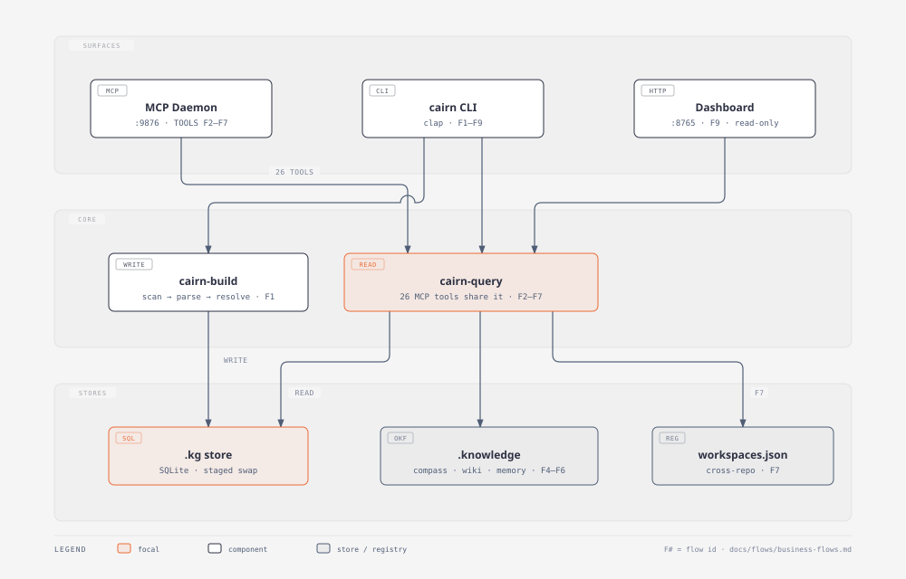

# Flow reference

Canonical business-flow reference for implementing, maintaining, and testing
cairn. Stable flow IDs (F1–F9) join code, tests, PRs, and charts to one map.

| Activity | Start here |
| --- | --- |
| Implement | [business-flows.md](business-flows.md) + [flow overview](chart-1-flows-overview.svg) — locate the flow your change lands in; the doc gives the entry → core → store path with `file:line` |
| Maintain | [dev priorities](chart-2-dev-priorities.svg) — living risk backlog; re-verify each finding at every audit before acting on it |
| Test | [coverage.md](coverage.md) — test files per flow, regenerated by `cargo xtask flow-coverage`; zero-coverage flows are where new tests are owed first |

## Flow registry

| ID | Flow | Entry surface |
| --- | --- | --- |
| F1 | Graph indexing / build pipeline | CLI `build` `update` `import-scip` `sync` |
| F2 | Graph query & navigation | MCP nav/flow tools + ~19 CLI commands |
| F3 | Semantic search & embedding index | MCP `semantic_search` + CLI `semantic` `embed` |
| F4 | Knowledge base, compass, routing | MCP `knowledge_*` `ask_compass` + CLI `knowledge` `ask` |
| F5 | Wiki generation via LLM task queue | MCP `wiki_generate` + CLI `wiki` `task` |
| F6 | Memory lifecycle | MCP `record_memory` `recall_memory` + CLI `memory *` |
| F7 | Federation & cross-repo | MCP `federated_search` `cross_repo_deps` + CLI `federated-search` `deps` |
| F8 | MCP daemon serving | CLI `serve` `connect` + HTTP `/mcp` `/healthz` |
| F9 | Read-only web dashboard | CLI `dashboard` + HTTP routes |

Flow-to-pattern definitions (name + test-matching patterns) live in
[flows.json](flows.json); extend it there when flows merge or split, never
in the tooling.

## Conventions

- PR descriptions name affected flows (e.g. `flows: F2, F7`); reviewers pull
  the flow's section from [business-flows.md](business-flows.md).
- Tests may tag their flow (`// F#`) for first-class counting; untagged tests
  are matched by the symbol patterns in `flows.json`.
- Run `cargo xtask flow-coverage` when tests are added or removed and commit
  the regenerated [coverage.md](coverage.md).
- Re-trace the flows per release and diff against
  [business-flows.md](business-flows.md); line numbers drift, structure rarely
  does.

## Files

- [business-flows.md](business-flows.md) — the map: 9 flows, per-flow entry
  points, step paths, stores, test touchpoints
- [chart-1-flows-overview.html](chart-1-flows-overview.html) / [.svg](chart-1-flows-overview.svg) — architecture map
- [chart-2-dev-priorities.html](chart-2-dev-priorities.html) / [.svg](chart-2-dev-priorities.svg) — impact × effort backlog
- [chart-3-test-coverage.html](chart-3-test-coverage.html) / [.svg](chart-3-test-coverage.svg) — test files per flow (snapshot; coverage.md is the live truth)
- [flows.json](flows.json) — machine-readable flow registry
- [coverage.md](coverage.md) — generated; do not edit by hand
