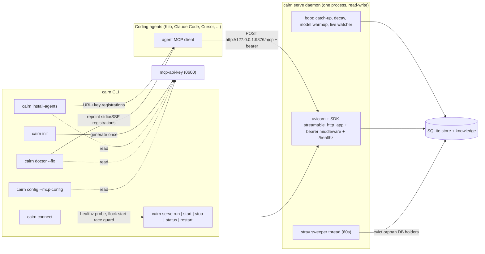

# Tech Spec: mcp-streamable-http

**Spec**: [spec.md](spec.md) | **Created**: 2026-10-11
**Every file/symbol citation below must come verbatim from [survey.md](survey.md)
or a grep run in this session — never from memory.**

## Architecture

One always-on daemon process owns the store. The serving stack is exactly
today's HTTP branch: the SDK's `streamable_http_app()` under uvicorn, wrapped
by the bearer middleware with the `/healthz` exemption, plus the existing
boot sequence (catch-up, memory decay, model warmup, live watcher) that now
runs on the default read-write path. Everything else in the picture is CLI
surface that either ensures the daemon exists (`connect`, `serve` manager),
points clients at it (`install-agents`, `config --mcp-config`, `doctor
--fix`), or protects its single-writer discipline (stray sweeper). The stdio
and SSE transports, the stdio parent-death watchdog, and the installer
spawn-probe do not exist in this architecture.

## Solution

### Chosen approach

The HTTP substrate already exists and is test-pinned (survey FR-001/FR-011:
`_build_http_app` at `src/cairn/mcp_server/server.py:237`, parity and auth
probes in `tests/test_http_transport.py`). The work is subtraction plus
lifecycle: delete the other two transports, flip the writability default,
add `cairn connect` as the ensure-running entrypoint, move registrations to
URL+key form, and repoint doctor's fix in the new direction.

FR coverage:

| Requirement | Design |
|-------------|--------|
| FR-001 | D-001 (HTTP-only `run()`), D-002 (refusals), D-013 deletions |
| FR-002 | D-003 (read-write default; `--read-only` opt-out) |
| FR-003 | D-002 (non-zero refusal naming the HTTP replacement) |
| FR-004 | D-004 (`connect`: healthz probe, flock single-flight, detached start, URL emit) |
| FR-005 | D-006 (key generated at init, 0600, embedded in configs; serve resolution unchanged; bind policy untouched via D-001) |
| FR-006 | D-007 (URL+key registrations), D-008 (healthz-based verification) |
| FR-007 | D-009 (Claude Desktop reported unsupported, nothing written) |
| FR-008 | D-010 (sweeper on the HTTP path; pidfile pid protected) |
| FR-009 | D-011 (doctor flags stdio/SSE; `--fix` repoints to URL+key) |
| FR-010 | D-005 (serve manager on HTTP; launchd + daemonize fallback) |
| FR-011 | D-001 (SDK app stays the only builder), D-013 (zero new deps) |

### Alternatives rejected

| Alternative | Why rejected |
|-------------|--------------|
| Keep stdio as a hidden compat mode behind a flag | Keeps the per-client spawn machinery this spec exists to delete (survey FR-001 gap: three transports compiled in, stdio default); intent.md Q5 ruled a clean break in 0.23.0 |
| Fold ensure-running into `serve start`, no `connect` command | intent.md Q2 ruled both, split by role: `connect` is the agent/human entrypoint, `serve` the manager; one command doing both conflates ensure semantics with manager flags |
| Port-bind race as the singleton guard (no lock) | Check-then-act only today (survey NFR-004: `serve.py:158-161`, no lock machinery); two racing starters produce a bind-failure crash and, under launchd KeepAlive, a restart fight |
| Pidfile with O_EXCL as the race guard | A stale pidfile after a crash needs heuristic cleanup; an flock is kernel-released when the holder dies, so possession is liveness |
| Serve auto-loads the persisted key file | Breaks the pinned pre-bind refusal of unkeyed non-loopback binds (survey NFR-001: `test_refuse_predicate_exits_unkeyed_non_loopback`, CI keyless-wildcard smoke) and would key the default loopback daemon, ending unkeyed loopback dials that FR-005 keeps permitted |
| launchd only, no non-macOS fallback | `serve start` exits 1 off-macOS today (survey FR-010: `serve.py:147-150`); FR-010 mandates a daemonize fallback |
| Hand-rolled JSON-RPC endpoint instead of the SDK app | FR-011 bans hand-rolled transport; the SDK builder is the only one today (survey FR-011: no `jsonrpc` hits outside the LSP client) |
| New deps (filelock, daemonize, keyring packages) | C-03 dependency gate; `fcntl`, `os`, `secrets`, `http.client` cover every need (D-013); wheel/platform matrix stays untouched |
| Per-workspace API keys | The daemon is one per machine/port (port 9876 pinned across lifecycle.py, Dockerfile, CI per survey FR-005 and supporting evidence); a per-workspace key would not map to a per-machine endpoint |

## Impact analysis

Graph tools were not available in this session; every count below is a
manual grep resolution. Caveat: `run` is a common name — a fuzzy sweep of
`.run(` also matched `uvicorn.run` (`src/cairn/cli/dashboard.py:56`) and
`health_check.run` (`src/cairn/cli/system/doctor.py:964`), both unrelated to
the MCP server's `run`.

| Symbol (file) | Direct callers today | Breakage |
|---------------|----------------------|----------|
| `run` (`src/cairn/mcp_server/server.py:259`) | 1 production caller (`_serve_foreground`, `src/cairn/cli/serve.py:131`) + 7 test call sites (`tests/test_http_transport.py:27`, `:31` boot scripts, `tests/test_core_smoke.py:296`, `tests/test_server_robustness.py:51`, `:95`, `:126`, `:335`) | Signature loses `transport`; every caller updates or dies with stdio |
| `_serve_foreground` (`src/cairn/cli/serve.py:107`) | `serve` (`:51`), `serve_run` (`:101`), `tests/test_http_transport.py:513`, `:537` | Default logic at `:118-126` deleted; flag-pin table flips |
| `mcp_config_json` family (`src/cairn/agent_install/_common.py:90`, `:72`; per-client wrappers in `src/cairn/agent_install/clients/`) | 9 installers + `src/cairn/cli/system/doctor_fix.py:17-38` + shape pins in `tests/test_clients.py:153-154`, `:177-178`, `:187-189` | Return shape flips to URL+key; stdio branch deleted |
| `sse_url` / `sse_responds` (`src/cairn/mcp_server/lifecycle.py:331`, `:335`) | `src/cairn/cli/serve.py:158`, `:160`, `:184`, `:193`, `:245`, `:267`; `sse_daemon_reachable` (`src/cairn/agent_install/__init__.py:132`); monkeypatched in `tests/test_doctor_fix.py:30`, `:129`, `tests/test_core_smoke.py:328` | Replaced by mcp-URL + healthz helpers; every probe site renames |
| `render_plist` (`src/cairn/mcp_server/lifecycle.py:53`) | `serve_start` (`src/cairn/cli/serve.py:172`); pinned in `tests/test_port_dry_and_unload_fixes.py:103`, `:116`, `:122`, `:131` | `read_only` default flips; args drop `--read-only` |
| `verify_registration` / `_verify_results` (`src/cairn/agent_install/__init__.py:247`, `:300`) | doctor's `_registration_findings` (`src/cairn/cli/system/doctor.py:750` region imports it) and the install flow | Spawn-probe deleted; healthz verification replaces it |
| `install` (`src/cairn/agent_install/__init__.py:325`) | `install_agents` (`src/cairn/cli/agents.py:151`); tests pass `transport="sse"`/`"stdio"` (`tests/test_clients.py:36`, `:75`, `:87`, `tests/test_install_uninstall_fidelity.py:675`) | `transport`/`sse_url` params deleted; call sites flip |
| `apply_doctor_fixes` / `_stdio_config` (`src/cairn/cli/system/doctor_fix.py`) | `doctor --fix` (`src/cairn/cli/system/doctor.py:1041`); pinned by all of `tests/test_doctor_fix.py` | Repoint direction flips to URL+key |
| `resolve_api_key` (`src/cairn/mcp_server/auth.py:8`) | `_serve_foreground` (`src/cairn/cli/serve.py:133`), `tests/test_auth.py`, `tests/test_http_transport.py:537-561` | **Unchanged** — preservation is the point (NFR-001) |
| `_install_stray_sweeper` (`src/cairn/mcp_server/server.py:450`) | SSE branch only (`:390-393`); never on the http path (`:406-427`) | Moves onto the sole serving path |
| `config --mcp-config` branch (`src/cairn/cli/core.py:209-216`) | echoed hint at `src/cairn/cli/core.py:280`; no test pins the output (grep over `tests/` found none) | Shape flips to URL+key; new pin needed (test.md owns it) |
| Dockerfile ENTRYPOINT / CI smoke | `Dockerfile` ENTRYPOINT `cairn serve --transport http --host 0.0.0.0`; `.github/workflows/ci.yml` smoke steps invoke the same flag form | Flag form flips to bare `cairn serve --host 0.0.0.0` (env-key flow unchanged) |

### Test-tree sweep for flipped defaults

Classes per the design spine: flag pins, exact-count pins, exact-traffic
pins, behavior pins. The first three are enumerated; behavior pins are
named where they migrate.

**Flag pins (assertions on the flag/default surface that flips):**

- `tests/test_http_transport.py:513` `test_serve_foreground_maps_flags_to_run`
  — all six parametrize rows (`:505-510`) pin transport default, the
  port-implies-SSE rule, and `CAIRN_READ_ONLY` per transport; every row
  flips or dies.
- `tests/test_http_transport.py:537` `test_serve_foreground_resolves_api_key_flag_over_env`
  — pins flag-over-env key precedence; keeps passing once `transport=`
  kwargs are dropped from the call.
- `tests/test_install_uninstall_fidelity.py:662` `test_zcode_global_install_migrates_legacy_config`
  — passes `transport="sse"` and asserts the migrated entry is
  `type == "sse"` (`:675-679`); repins to the URL+key shape.
- `tests/test_clients.py:87` — `install(..., transport="sse")` exercises the
  SSE config path; becomes the URL-config path.
- `.github/workflows/ci.yml` keyless-wildcard and keyed smoke steps pin the
  `--transport http` CLI form (outside pytest, still a flag pin).

**Exact-count pins (unchanged by this spec — guarded, not flipped):**

- `src/cairn/mcp_server/server.py:52` `_EXPECTED_TOOL_COUNT = 26`, asserted
  by `verify_tool_count` (`:131`) and `tests/test_server_robustness.py:164`
  `test_tool_count_assertion` — no tool changes land here.
- `tests/test_http_transport.py:448` `test_healthz_route_registers_exactly_once`
  and `:473` `test_healthz_payload_shape_on_reachable_store` — healthz route
  count and payload key set stay byte-identical (NFR-001 preservation).

**Exact-traffic pins:**

- Preserved verbatim (NFR-001): `tests/test_http_transport.py:363`
  `test_bearer_middleware_rejects_before_invoking_app`, `:374` allows-valid,
  `:387` healthz-exempt, `:404` transport-security-by-bind-class, `:427`
  refuse-predicate, `:440` unkeyed-wildcard refusal, `:567` keyed loopback
  401/421/200, `:613` keyed stateless wildcard, `:635` unkeyed non-loopback
  pre-bind refusal.
- Flipped: `tests/test_doctor_fix.py:52`
  `test_repoints_each_client_shape` pins the `repointed-to-stdio` action
  literal (`:110`) and exact rewritten stdio shapes; `:121`
  `test_healthy_endpoint_returns_no_actions`, `:136`
  `test_stdio_registration_with_stale_url_is_unchanged` (stdio becomes the
  thing repointed, not preserved), `:159`
  `test_fresh_config_is_refused_without_backup`, `:180`
  `test_workspace_owned_config_is_skipped_and_guided` — the whole file
  repins to the URL+key direction.
- Flipped: exact-dict shape pins `tests/test_clients.py:153-154`,
  `:177-178`, `:187-189` on the generator outputs.

**Behavior pins that migrate (not delete):** `tests/test_core_smoke.py:284`
boot guard, `:300` read-only blocks writes, `:328`
`sse_responds`-live-vs-dead (renames to the healthz probe);
`tests/test_server_robustness.py` boot-guard class (`:51`, `:95`, `:126`)
and valid-store boot (`:320-335`) boot via `run(transport="stdio")` and move
to HTTP boots; `tests/test_http_transport.py:232`
`test_http_tool_catalog_matches_stdio` loses its stdio side and repins the
HTTP catalog against the registered tool-name set (independent source: the
`@mcp.tool` registry re-counted in survey supporting evidence — 26 across
`tools_*.py`); `tests/test_server_robustness.py:277`
`test_watchdog_drains_before_os_exit` dies with the watchdog
(`_install_exit_watchdog`, `src/cairn/mcp_server/server.py:104`).

## Quality, threats, and rollback

| Requirement | Design consequence / threat mitigation | Rollback or verification |
|-------------|----------------------------------------|--------------------------|
| NFR-001 Security | D-001 keeps `_build_http_app`, `_BearerAuthMiddleware`, `_transport_security_for`, `_require_http_api_key` untouched; D-006 keeps serve key resolution flag-over-env so pre-bind refusal still fires; every preserved traffic pin above stays green | `CAIRN_LIB=/tmp/__no_such_lib__ uv run --extra test pytest tests/test_http_transport.py tests/test_auth.py -q` |
| NFR-002 Privacy | Key file written with mode 0600 at creation (os.open with the mode argument), never printed: installers embed it into configs, doctor echoes presence only (pattern at `src/cairn/cli/system/doctor.py:641-644`), the 401 path never logs credentials (`src/cairn/mcp_server/server.py:178-181`) | Test pins file mode and that no CLI output contains the key literal |
| NFR-003 Performance | Daemon boots once; every client is an HTTP client, so a second client's first tool call hits the warm process (no catch-up, no warmup re-run — boot work sits ahead of serving, survey NFR-003 evidence); stdio per-client spawns no longer exist to pay boot tax | Two-client scenario test (test.md owns the TC); existing boot-order pins |
| NFR-004 Reliability | flock single-flight around check-sweep-start-wait (D-004); crashed daemon = port free = next connect healthz-fails, sweeps, starts; flock is kernel-released on holder death, so no stale-lock cleanup path exists | Concurrent-connect convergence test; crash-replacement test |
| NFR-005 Observability | `/healthz` and the readiness line (`src/cairn/mcp_server/server.py:414-418`) unchanged; connect prints started-vs-reused plus the URL (D-004) | healthz pins at `tests/test_http_transport.py:448`, `:473`; connect output pin |
| NFR-006 Accessibility | Not applicable — the spec's surfaces are CLI commands and JSON config files (spec.md declares it); no UI machinery is added to "compensate" | none |

Threat model (auth, secrets, persistence, migration, privileged operations):

- **Assets**: the SQLite store (single writer), the persisted API key,
  client config files.
- **Off-loopback exposure**: an unkeyed non-loopback bind is refused before
  binding (`_require_http_api_key` pre-bind exit, survey NFR-001); keyed
  binds enforce the bearer middleware; DNS-rebinding/Origin protection rides
  `_transport_security_for`. Residual: a user keying a loopback daemon via
  env changes loopback dial behavior for configs lacking the key — doctor
  surfaces key presence so the mismatch is diagnosable.
- **Secret leakage**: key never logged (existing prohibition); configs embed
  it in user-owned files. Residual: a workspace `.mcp.json` containing the
  key could be committed to a repo. Accepted because the default loopback
  daemon does not enforce the key (D-006), so the embedded value is dormant
  on loopback; recorded here rather than silently dropped.
- **Orphaned daemons**: the sweeper evicts verified DB holders (SIGTERM →
  SIGKILL, `terminate_pid` with cmdline re-check, survey FR-008); the HTTP
  daemon itself is protected by launchd pid or pidfile pid (D-010). A failed
  lsof verification aborts the sweep rather than killing blind
  (`find_strays` returns empty on unverifiable state, survey FR-008).
- **Migration**: 0.23.0 breaks every stdio consumer deliberately (intent Q5);
  `doctor --fix` repoints registrations; Claude Desktop users lose cairn
  MCP support and are told so explicitly (D-009). Residual: users who never
  run doctor keep dead stdio entries until they do.
- **Privileged operation**: none — everything runs as the user; launchctl,
  pgrep, lsof usage is unchanged in kind.

Rollback strategy: no store schema migration exists in this spec, so
rollback is code-only (revert the release / pin 0.22.x). A 0.22.x daemon
serves SSE at `/sse`, so URL+key configs written by 0.23 must be regenerated
by the older installer or doctor — the release notes carry that step; it is
the one manual rollback cost.

## Code guide

### MCP server transport
- Touches: `run` and the transport branches in `src/cairn/mcp_server/server.py` (survey FR-001: branches at `:390`/`:406`/`:429`; watchdog `:104`)
- Approach: D-001 — the http branch body becomes `run()`'s body; delete the `transport` parameter, the sse/stdio branches, and `_install_exit_watchdog`; install `_install_stray_sweeper` on the sole path (D-010)
- Verify before implementing: `CAIRN_LIB=/tmp/__no_such_lib__ uv run --extra test pytest tests/test_http_transport.py -q`
- Pitfalls: `mcp.settings` is a singleton — tests reset it via fixtures (`_http_singleton_settings`); stdout readiness line must stay (NFR-005); boot work must stay ahead of serving (NFR-003)

### Serve CLI and connect
- Touches: `serve`, `serve_run`, `_serve_foreground`, `serve_start/stop/status/restart` in `src/cairn/cli/serve.py` (survey FR-003/FR-010)
- Approach: D-002 tombstones, D-003 default flip (delete the `read_only = bool(port) or transport == "http"` line at `:125-126`), D-004 `connect` as a `@main.command` here (daemon lifecycle is this module's charter); D-005 shares one ensure-running core with `serve start`
- Verify before implementing: `CAIRN_LIB=/tmp/__no_such_lib__ uv run --extra test pytest tests/test_http_transport.py -q` (flag-wiring tests live there)
- Pitfalls: `serve restart` invokes stop+start via ctx (survey FR-010) — keep that composition; the macOS start path must sweep strays before load (existing `:163-167` behavior); non-macOS must not exit 1 anymore

### Daemon lifecycle, lock, daemonize
- Touches: `render_plist`, `sweep_strays`, `find_strays`, `sse_url`, `sse_responds` in `src/cairn/mcp_server/lifecycle.py` (survey FR-008/FR-010)
- Approach: D-005 (label migration to a non-sse name with a legacy-unload branch, daemonize + pidfile fallback), D-008 (healthz probe helpers replace the TCP probe), D-010 (pidfile pid joins the protected set with cmdline re-verification)
- Verify before implementing: `CAIRN_LIB=/tmp/__no_such_lib__ uv run --extra test pytest tests/test_stray_sweeper_safety.py tests/test_port_dry_and_unload_fixes.py -q`
- Pitfalls: `find_strays` protects launchd pid + self (`:209-212`) — the daemonize fallback daemon has neither launchd nor the sweeping pid, hence the pidfile protection; lockfile lives at CAIRN_HOME so one lock covers the one machine-level port; never hold the flock for the daemon's lifetime — it guards the start sequence only

### Key lifecycle
- Touches: `init` in `src/cairn/cli/core.py` (survey FR-005: no key step today); `resolve_api_key` in `src/cairn/mcp_server/auth.py` stays untouched
- Approach: D-006 — generate `secrets.token_urlsafe` once at init, persist at CAIRN_HOME with 0600 via os.open mode; readers are the generators only
- Verify before implementing: `CAIRN_LIB=/tmp/__no_such_lib__ uv run --extra test pytest tests/test_cli_init_rail.py tests/test_auth.py -q`
- Pitfalls: init is idempotent — regenerate only when the file is absent; never print the key in the rail output (NFR-002)

### Agent installers
- Touches: `mcp_config_json`, `opencode_format_mcp_config_json`, `CLIENTS` in `src/cairn/agent_install/_common.py`; `install`, `verify_registration`, `_verify_results`, `sse_daemon_reachable` in `src/cairn/agent_install/__init__.py`; per-client modules incl. `src/cairn/agent_install/clients/claude_desktop.py`; `install_agents` in `src/cairn/cli/agents.py` (survey FR-006/FR-007)
- Approach: D-007 (URL+key on the `/mcp` path, stdio branch deleted, `--sse`/`--stdio`/`--sse-url` flags removed), D-008 (healthz verification, spawn-probe deleted), D-009 (claude-desktop becomes an unsupported report)
- Verify before implementing: `CAIRN_LIB=/tmp/__no_such_lib__ uv run --extra test pytest tests/test_clients.py -q`
- Pitfalls: the explicit `"type"` field in URL entries exists for cross-client compat (survey FR-006: `_common.py:94-96`) — keep an explicit type, value per client surface, pinned per client by these tests; the install-time daemon gate (`agents.py:164`) flips to the healthz probe and names `cairn connect` in its hint

### Doctor
- Touches: `_registration_findings`, `_REG_WS_FILES`/`_REG_HOME_FILES`, `_fix_summary_lines`, `doctor --fix` help in `src/cairn/cli/system/doctor.py`; `_stdio_config`/`_replace_registration`/`apply_doctor_fixes` in `src/cairn/cli/system/doctor_fix.py` (survey FR-009)
- Approach: D-011 — flag by transport class, repoint stdio/SSE to URL+key via the same generators; add the Claude Desktop config path (`claude_desktop_config_path`, `src/cairn/agent_install/detect.py:12`) to the audit tables flagged with a removal hint, never repointed; keep the freshness refusal and workspace-owned skip behaviors
- Verify before implementing: `CAIRN_LIB=/tmp/__no_such_lib__ uv run --extra test pytest tests/test_doctor_fix.py -q`
- Pitfalls: the `.json.bak` backup-before-write and secret-redaction assertions (`tests/test_doctor_fix.py:113-117`) must survive the direction flip

### Config, docs, CI surface
- Touches: the `--mcp-config` branch in `src/cairn/cli/core.py:209-216`; `mcp.json.template`; `README.md`; `AGENTS.md`; `docs/cli-reference.md`; `docs/configuration.md`; `Dockerfile` ENTRYPOINT; `.github/workflows/ci.yml` smoke steps; `specs/INDEX.md` (supersession note for remote-mcp-oauth, listed at `specs/INDEX.md:8`)
- Approach: D-012 — URL+key snippet (keyless URL form when no key file exists, since loopback serves unkeyed); template rewritten; docs sweep of stdio/SSE mentions; Docker/CI flag forms drop `--transport http`
- Verify before implementing: `grep -rn "stdio\|--transport" README.md AGENTS.md docs/ mcp.json.template` reaches zero stale hits
- Pitfalls: the Docker env-var key flow (`CAIRN_MCP_API_KEY`) is load-bearing for the CI keyless-refusal smoke — do not "simplify" it away

## References

- [survey.md](survey.md) — code-state evidence; every citation above traces here or to this session's greps
- [intent.md](intent.md) — rulings: clean break (Q5), connect+serve split (Q2), key at init (Q3), Claude Desktop drop (Q4), remote-mcp-oauth supersession (Q6)
- [research.md](research.md) — skip marker: no open choices at Stage 0; transport shape settled on the SDK's streamable HTTP app
- `specs/CONSTITUTION.md` — C-02 test-first, C-03 dependency gate (satisfied by D-013), C-04 test isolation
- `specs/archive/2026-10-07-http-mcp-serving/` — provenance of the HTTP substrate and its probe conditions (survey supporting evidence)
- `specs/remote-mcp-oauth/spec.md` — dormant spec whose stdio-preservation FR this spec supersedes; INDEX note ships with delivery

## Decisions

### D-001: HTTP-only `run()`; the SDK app is the only transport
- **Context**: Three transports are compiled in and stdio is the default (survey FR-001); FR-011 bans hand-rolled transport and pins the SDK surface.
- **Decision**: `run()` loses its `transport` parameter; today's http branch (build app via `mcp.streamable_http_app()`, uvicorn server, stdout readiness line) becomes the entire body; the sse and stdio branches, and the stdio parent-death watchdog, are deleted.
- **Consequences**: One serving path, one readiness line, one stray-sweeper install point; every `run(transport=...)` caller (1 production, 7 test sites) updates; protocol revisions arrive only via SDK bumps inside the `mcp>=0.9.0,<2.0.0` pin (survey FR-011).

### D-002: Removed transports refuse with a pointer, not a usage error
- **Context**: FR-003 requires a non-zero exit whose message names the HTTP replacement for any stdio/SSE-specific option, including removed `--transport` values; click's default unknown-option error is non-zero but names nothing.
- **Decision**: `--transport` disappears from help and docs but survives as a hidden tombstone option on `serve` and `serve run` that prints the replacement (the daemon URL form plus `cairn connect`) and exits non-zero for any value; `--port` stays (it is the HTTP daemon's port now).
- **Consequences**: Scripts passing old flags get an actionable message instead of bare usage text; the surface stays removed in effect — a red-flag shape (a flag that exists only to fail) kept because the FR demands the message, recorded here rather than silently.

### D-003: Daemon runs read-write by default
- **Context**: HTTP/SSE serving defaults read-only today (survey FR-002: `serve.py:125-126`, plist pins `--read-only` at `lifecycle.py:77-80`); FR-002 and NFR-003 require the warm, writable daemon as the default.
- **Decision**: Delete the auto-read-only default in `_serve_foreground`; `--read-only` remains the explicit opt-out; `render_plist` default flips to read-write and stops appending `--read-only`; `run()`'s CAIRN_READ_ONLY gating is untouched.
- **Consequences**: The single daemon is the single writable server (SQLite single-writer discipline preserved — concurrent agents are HTTP clients, not processes); read-only replicas remain available for operators.

### D-004: `cairn connect` — probe, single-flight, ensure, report
- **Context**: FR-004/NFR-004/NFR-005: no connect command or race guard exists (survey FR-004, NFR-004); today's reuse check is check-then-act only.
- **Decision**: New top-level command: GET `/healthz` on the configured host:port; healthy → emit URL, report `reused`. Otherwise take an exclusive flock on a lockfile under CAIRN_HOME (fcntl, stdlib), sweep strays, run the platform start core (D-005), wait bounded for healthz, emit URL, report `started`; a concurrent loser blocks on the flock (bounded), then re-probes and reports `reused`.
- **Consequences**: Concurrent first starts converge to one daemon; the flock guards only the start sequence (possession is liveness — kernel-released on crash); a crashed daemon is replaced by the next connect with no manual cleanup; the singleton gate remains port-bind + healthz, not a lifetime lock.

### D-005: One platform start core — launchd on macOS, daemonize+pidfile elsewhere
- **Context**: FR-010 mandates the existing launchd mechanism plus a non-macOS fallback; `serve start` exits 1 off-macOS today (survey FR-010); `connect` and `serve start` must not grow two start paths.
- **Decision**: A single ensure-running core in `lifecycle.py`: macOS reuses write-plist/load/wait (today's `serve_start` body); elsewhere it forks, setsid, redirects stdio to a log under CAIRN_HOME, execs `cairn serve run --port N`, and writes the daemon pid to a pidfile. `serve stop/status` read launchd or the pidfile. The LaunchAgent label and log name lose their `sse` naming, with a one-time legacy-label unload before the first new load.
- **Consequences**: `connect` and `serve start` share correctness (stray sweep before start, healthz wait); a stale installed plist cannot leave an old-label daemon fighting the new one for the port; the pidfile feeds D-010's protection.

### D-006: API key generated at init, persisted 0600, feeds generators only
- **Context**: FR-005/NFR-002: init generates and persists `CAIRN_MCP_API_KEY`; configs embed it; unkeyed loopback dials stay permitted; NFR-001 pins the existing serve auth behavior.
- **Decision**: `cairn init` generates a `secrets.token_urlsafe` value once and persists it at CAIRN_HOME with mode 0600. Readers: the installer generators, `config --mcp-config`, and doctor's repoint. The serve path's key resolution is unchanged (flag over env, `resolve_api_key`) — the file never feeds the daemon.
- **Consequences**: The pre-bind refusal of unkeyed non-loopback binds and the CI keyless-wildcard smoke keep firing; the default loopback daemon is keyless so unkeyed loopback dials succeed (the embedded key in configs is dormant there and correct the day an operator keys the daemon via env); residual — the key sits in user-owned config files (accepted, recorded in the threat model).

### D-007: Registrations flip to URL+key on `/mcp`
- **Context**: FR-006: every supported client's registration is URL + key; today's URL entries are keyless SSE shapes and stdio branches still exist (survey FR-006, FR-007).
- **Decision**: Generator stdio branches are deleted; URL entries point at `http://127.0.0.1:9876/mcp` (the readiness-line path); the key is embedded via each client's URL-config surface, with per-client literals owned by the per-client generators and pinned by `tests/test_clients.py`; `install()`'s `transport`/`sse_url` parameters and the `--sse`/`--stdio`/`--sse-url` CLI flags are removed.
- **Consequences**: One registration form across 8 clients; clients whose surface has no header field get a keyless URL entry (harmless under D-006's loopback default); installer tests become the single shape authority.

### D-008: Verification probes `/healthz`, never a process
- **Context**: FR-006: verification probes the daemon health endpoint; today stdio registrations are spawn-probed (`config --json` subprocess) and URL entries skip verification (survey FR-006).
- **Decision**: The spawn-probe machinery is deleted; verification GETs `/healthz` derived from the registration's URL (http.client, bounded timeout, 200 = pass); `sse_daemon_reachable`'s bare TCP connect and the `sse_url`/`sse_responds` pair are replaced by an mcp-URL helper plus a healthz-probe helper in `lifecycle.py`.
- **Consequences**: Verification cost drops from a process spawn to one HTTP round trip; healthz is auth-exempt (`server.py:172` region, pinned by `tests/test_http_transport.py:387`) so probes work against keyed daemons too; all probe call sites rename.

### D-009: Claude Desktop reported unsupported, nothing written
- **Context**: FR-007: the client is stdio-only by design with no URL alternative (survey FR-007: `claude_desktop.py:28-32`); this spec removes stdio.
- **Decision**: The claude-desktop installer entry becomes an unsupported report: detection still lists the client, the result carries an explicit unsupported note, and no config file is written; uninstall keeps removing legacy entries; doctor flags desktop registrations with a removal hint rather than repointing them.
- **Consequences**: `CLIENTS` keeps a permanently non-installing entry — a mild red flag kept so existing users see a named reason instead of silent absence; the "8 remaining clients" assumption in spec.md maps to the other entries.

### D-010: Stray sweeper runs on the HTTP daemon; pidfile pid is protected
- **Context**: FR-008: the sweeper machinery is transport-agnostic but installs only in the SSE branch (survey FR-008: `server.py:390-393` vs `:406-427`); off-macOS, a second process sweeping would see the daemonize daemon as a stray (its cmdline matches `_is_cairn_serve_cmdline` and it holds the DB, while `running_pid()` is None off-macOS).
- **Decision**: `_install_stray_sweeper` runs on the sole serving path; `find_strays`' protected set gains the pidfile pid, admitted only after its cmdline re-verifies as cairn serve (pid-reuse guard).
- **Consequences**: Orphan eviction works identically under HTTP; the unmanaged Linux daemon cannot be evicted by its peers; the lsof-verification abort behavior (never kill unverified) is preserved.

### D-011: Doctor repoints stdio/SSE registrations to URL+key
- **Context**: FR-009: today's `--fix` repoints dead SSE registrations *to stdio* (survey FR-009: help at `doctor.py:1039`, summary at `:1006`) — exactly backwards after the break.
- **Decision**: The audit flags cairn-owned registrations by transport class (stdio spawn-shaped, SSE endpoint); `--fix` rewrites them to the URL+key form via the same generators the installers use; the freshness refusal, backup-before-write, secret redaction, and workspace-owned-skip behaviors carry over unchanged; the summary and `--fix` help flip wording.
- **Consequences**: Upgrading users converge with one command; doctor_fix shares the generators' shape authority; desktop-registered users get the D-009 removal hint instead of a repoint.

### D-012: Config/template/docs/CI surface follows the daemon
- **Context**: FR-005/FR-006 adjacent surface: `config --mcp-config` prints the stdio form (survey supporting evidence: `core.py:209-216`), `mcp.json.template` is the stdio shape, Docker/CI invoke `--transport http` explicitly (session grep), and `specs/INDEX.md` still lists remote-mcp-oauth as draft.
- **Decision**: `--mcp-config` prints the URL+key JSON (keyless URL form when no key file exists); the template is rewritten; README/AGENTS/docs lose stdio/SSE instructions; Dockerfile ENTRYPOINT and CI smoke steps drop the flag; INDEX.md gains the supersession note.
- **Consequences**: Every printed or generated snippet dials the daemon; the CI keyless-refusal smoke keeps its teeth via the unchanged env-var key flow.

### D-013: Zero new runtime dependencies
- **Context**: C-03 requires a recorded decision for any new runtime dependency; the needed primitives are lock (flock), detach (fork/setsid), key generation (secrets), and health probe (http.client) — all stdlib; uvicorn/starlette already arrive via the `mcp` pin (pyproject.toml:46 comment, session grep).
- **Decision**: No new dependencies; the wheel/platform matrix is untouched by this spec.
- **Consequences**: C-03 satisfied by construction; any future dependency added during implementation must land here as its own D-### first.

### D-014: Wave-4 boot migration joins the T003 red window (T001 deviation)
- **Context**: T001 migrated `_BOOT_HTTP` and the api-key-resolution calls off `transport='http'` beyond the literal task text; T003 deletes the kwarg touching only server.py, so unmigrated boots would TypeError at T003's verify anchor with no later task owning the file.
- **Decision**: Accepted as required; the three keyed-traffic pins (NFR-001 preservation set) join the same red window as the mandated rows, green again at T003.
- **Consequences**: NFR-001's "stays green" reading is scoped to post-T003; the assertions themselves are unchanged.

### D-015: HTTP boot helpers duplicated across two test files until delivery (T002 deviation)
- **Context**: T002 needed live-boot/MCP-over-HTTP helpers that live in test_http_transport.py (concurrently rewritten by T001); extraction into a shared helper crossed T002's Touches and would collide with the wave.
- **Decision**: Two copies accepted until the delivery pass; the cleanliness sweep extracts to a shared helper at that point; a third copy triggers immediate extraction as its own task.
- **Consequences**: Temporary duplication inside tests/ only; no production surface affected.

### D-016: TC-015's shell pass-condition is macOS-blind; the pytest pin is authoritative (T012 deviation)
- **Context**: TC-015's acceptance command uses `grep -rl | xargs grep -l` against the desktop config path, which contains spaces on macOS — the pipeline splits and the command reports a false green while the stdio file exists.
- **Decision**: tests/test_clients.py's desktop-unsupported pin is the authoritative TC-015 check; qa re-briefs the shell command to null-delimited form (`grep -rlZ | xargs -0`) before the proofs step.
- **Consequences**: No test.md edit during execution (the re-brief is queued for the delivery pass); the false-green path is closed by the pytest guard in the meantime.

### D-017: The healthz-reuse gate wins the daemonize-pin conflict (T008 deviation)
- **Context**: T006's daemonize-child pin stubs `healthz_responds → True` yet expects the fork/exec child to run; the same file pins the healthy-reuse path (`test_healthy_daemon_reused_not_respawned`) to never fork under the identical mock state — the two pins are mutually exclusive under any deterministic pre-fork gate.
- **Decision**: D-004's probe model is authoritative — healthy means reuse; the daemonize-child pin's stub flips to pre-spawn-unhealthy so the child path is exercised deterministically. Implementation unchanged (proof: replicating the pin's mocks with only the healthz stub pre-spawn-unhealthy drives the full child exec and satisfies every assertion).
- **Consequences**: One-line test fix in T006's file by its owner; no production change; the race-convergence and reuse pins keep their teeth.

### D-018: connect takes a sibling lockfile, not the start-lock (T010 deviation)
- **Context**: `ensure_daemon_running` flocks `mcp-daemon.lock` internally; flock is per-open-file-description, so connect holding that same file across the ensure call self-deadlocks.
- **Decision**: connect flocks `mcp-connect.lock` (sibling under CAIRN_HOME) around its probe-sweep-ensure sequence; the core's own start-lock still serializes actual starts. A racing connect loser blocks on the connect lock, re-probes, reports reused.
- **Consequences**: Two locks with disjoint scopes; start serialization unchanged; the race pin's convergence contract holds.

### D-019: TC-012's shell literal is invocation-broken; the shell TC owns the snippet proof (T017 deviation)
- **Context**: test.md's TC-012 invokes `init "$d/ws" --no-build` positionally, but `init` accepts only `--workspace` (rc=2); with `--workspace` the full TC passes (`INIT_KEY_OK`). No pytest-side assertion of the `--mcp-config` snippet exists anywhere in tests/.
- **Decision**: The qa re-brief (with D-016's TC-015 fix) corrects the TC-012 command to the `--workspace` form; the shell TC remains the snippet's owner proof — no pytest duplicate is added (the keyed/keyless shapes are already pinned via T012's generator literals and T011's key-file pins).
- **Consequences**: test.md corrected at the delivery pass, not during execution; the snippet contract stays proven end-to-end.

### D-020: TC-016's shell literal is invocation-broken; corrected at the qa re-brief (T019 deviation)
- **Context**: test.md's TC-016 seeds via `init "$d/ws" --no-build` (positional workspace — init accepts only `--workspace`, rc=2 swallowed) and runs `doctor --fix` immediately after seeding, colliding with the T018-pinned 60s freshness refusal.
- **Decision**: The qa re-brief corrects the command: `init --no-build` with CAIRN_WORKSPACE set, plus an aging step (touch the seeded file past the freshness window) before `doctor --fix`. The outcome assertions are unchanged and hold end-to-end (T019's sandbox evidence).
- **Consequences**: test.md corrected with D-016 (TC-015 null-delimiting) and D-019 (TC-012 --workspace form) in the same qa pass, before proofs.

### D-021: TC-013/TC-014 share the positional-init defect; same fix as D-019/D-020
- **Context**: the qa re-brief found TC-013 and TC-014 still invoke `init "$d/ws" --no-build` positionally (rc=2 swallowed), failing at their key gates for the invocation reason, not the requirement.
- **Decision**: D-019's `--workspace` form applies to both, verbatim same-class fix; outcome assertions unchanged.
- **Consequences**: All five broken TC literals (TC-012/013/014/015/016) are corrected under one recorded class; proofs run them fresh.

### D-022: KeepAlive owns crash-replacement on macOS; TCs verify the outcome, not the corpse
- **Context**: TC-007/008/009 kill the connect-started daemon directly, but on macOS it runs under launchd with KeepAlive (D-005's plist shape) — kill -9 respawns within seconds, so "port free after kill" is unobservable and the respawned daemon poisons every later port-guard TC (the proofs-pass BUSY cascade).
- **Decision**: KeepAlive stays (production self-healing); NFR-004's "a crashed daemon is replaceable by the next connect without manual cleanup" is verified by outcome on macOS — after kill -9 the port returns to LISTEN (launchd respawn) and connect reports reused. The port-free corpse window belongs to the non-macOS daemonize path only. Every live TC ends with `serve stop` (manager unload), never a bare kill of a launchd-managed daemon.
- **Consequences**: TC-007/008/009 gain serve-stop cleanup; TC-008's gone-assertion flips to the respawn outcome; TC-004 (JSON literal), TC-006 (missing CAIRN_WORKSPACE export), TC-013 (missing build step) carry the same TC-command defect class as D-016/D-019/D-020/D-021; the proofs pass re-runs all TCs fresh afterward.

### D-023: Stray matcher accepts interpreter-prefixed argv (T008 fix round)
- **Context`: TC-009's orphan (venv console-script `serve`) is invisible to find_strays: shebang exec yields argv `[python3, …/cairn, serve, --port, N]`, but _is_cairn_serve_cmdline requires tokens[0] basename `cairn` — every venv/pipx/uv-launched serve escapes the sweeper. Pre-existing defect surfaced by the connect flow (sweep-before-start).
- **Decision**: The matcher accepts an optional interpreter prefix: `python* <path>/cairn serve …` (tokens[0] basename starts with python, tokens[1] basename cairn) in addition to the direct `cairn serve …` shape; the safety matrix in tests/test_stray_sweeper_safety.py gains rows for the shebang shape (and negative rows: python running anything else, interpreter prefix without serve).
- **Consequences**: Stray eviction works for all launch styles; TC-010's safety pins (never kill unverified, lsof DB cross-check) extend unchanged to the new shape.

### D-024: TC-014's count floor is machine-dependent; assert the supported set, not the file count
- **Context`: TC-014 asserts cnt >= 8 URL files under the sandbox HOME, but claude registers via its CLI (one file), droid's CLI may be absent (no file), and claude-desktop writes nothing by design — the live count is the set of file-writing clients actually installable on the machine (7 on the proof host).
- **Decision**: The count floor drops to >= 7 with the keyed check unchanged, and the assertion gains the "Installing for:" line naming all 8 supported clients (agy, claude, claude-desktop, cursor, droid, kilo, omp, opencode, zcode) — the supported set is the contract, the file count is environmental.
- **Consequences**: TC-014 is machine-independent; the last TC-command defect of the proof pass closes; the freeze re-records once over the corrected test.md.
