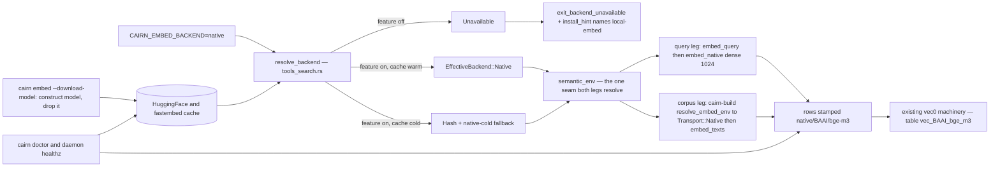

# Tech Spec: native-embed

**Spec**: [spec.md](spec.md) | **Created**: 2026-10-29
**Every file/symbol citation below must come verbatim from [survey.md](survey.md)
or a grep run in this session — never from memory.**

## Architecture

The native backend slots into the existing resolver-and-stamp architecture
rather than adding a parallel path. Both legs already route through one
resolver: the query leg runs `embed_query` and `ann_query` off one
SemanticEnv, and the corpus leg's `resolve_embed_env` in cairn-build
delegates to `cairn_query::tools_search::semantic_env` — cairn-build has no
independent resolver (survey FR-007). We add one enum variant, one transport
arm, one stamp, and one gated module. Everything downstream — persistence
keyed on (symbol_id, model), per-model vec0 tables, per-model reaping — is
stamp-agnostic machinery the survey verified complete (survey FR-004).

## Solution
### Chosen approach
- Opt-in cargo feature `local-embed` on cairn-query, forwarded by
  cairn-build, cairn-daemon, and cairn-cli, carrying fastembed as an optional
  pinned dependency with trimmed default features (D-001, D-003, D-004) —
  FR-001's build condition and NFR-001's tree posture.
- An explicit `native` arm in `resolve_backend` (D-007): feature-off builds
  resolve `Unavailable` with an install hint naming the cargo feature
  (FR-003); feature-on builds availability-probe the model cache — warm maps
  to `EffectiveBackend::Native`, cold maps to Hash with a native-cold
  fallback marker (FR-005). The probe belongs in the resolver because its
  documented contract is availability probing and fallback (survey:
  EffectiveBackend doc comment).
- An ungated stamp constant `native/BAAI/bge-m3` beside `HASH_MODEL`
  (D-009), scoping persistence, vec0 tables (sanitized to `vec_BAAI_bge_m3`
  — survey FR-004 test), and reaping (FR-004).
- A gated module `embed_native.rs` in cairn-query: a lazily-initialized
  process-wide model behind a mutex (D-006, NFR-004), dense 1024-dim
  embedding via the BGEM3 model card (D-002, FR-001), the cache probe, and
  the warm function used by the restored `EmbedArgs::download_model` flag
  (D-005, FR-002).
- Query leg: `embed_query` gains the Native dispatch arm. Corpus leg:
  `Transport::Native` inside `embed_texts`, preserving the batching, progress,
  and post-embed ANN rebuild wrappers (NFR-003). Both legs consume
  `semantic_env` only, so one configuration yields one stamp (FR-007) — now
  asserted by a parity test (survey FR-007 gap).
- Doctor: `check_embeddings` reports feature compiled, model cache state, and
  native embedding count in any build; the daemon healthz counts the
  native-cold fallback as a degradation (FR-006).

### Alternatives rejected
| Alternative | Why rejected |
|-------------|--------------|
| candle pure-Rust inference | bge-m3 is an XLM-R-large architecture: model code must be hand-rolled and weights verified ourselves (research.md, Embedding crate choice) |
| raw ort plus tokenizers wiring | reimplements pooling, normalization, and model-file mapping fastembed already ships (research.md, Embedding crate choice) |
| Bgem3Embedding dense+sparse+ColBERT surface | richer output than the dense-only 1024-dim stamp needs, at extra compute per embed (research.md RQ1 and bge-m3 surface) |
| hf-hub Api direct download for pre-warm | must mirror fastembed's four-file catalog list and cache-dir precedence — drift risk (research.md RQ3) |
| ort-load-dynamic | runtime dependence on a system ONNX Runtime with version drift — breaks the zero-infrastructure story of US1 (research.md, Feature trim / TLS / ort backend) |
| hf-hub-native-tls flavor | drags system OpenSSL against the Linux musl static release targets (research.md RQ2; specs/context/tech.md rust.yml matrix) |
| hf-hub 1.x async client | breaking rewrite; the pinned fastembed requires the 0.5 line (research.md RQ2) |
| keep the catch-all sending native to silent Hash | violates FR-003; survey flags it as the standing surprise and native stays indistinguishable from a typo |

## Impact analysis
<!-- Blast radius: what existing code/symbols this touches, who calls them,
     what breaks if the approach is wrong. Ground every claim in survey
     evidence. -->

- `resolve_backend` in `rust/crates/cairn-query/src/tools_search.rs` — direct
  consumer `semantic_env` (model per backend, survey lines 409-413). Changing
  the result for `native` flips a documented behavior, so per the lens rule
  the test tree is swept and pins classified. Behavior pin:
  `unknown_backend_names_resolve_to_local_semantics` (asserts unknown names
  resolve to local semantics — the catch-all arm stays, but if its fixture
  name is `native` the test flips; grep the test body before touching the
  arm). Copy pin: `install_hint_names_only_shipped_backends` (the hint gains
  a feature line, so its pinned names change). Both live in
  `rust/crates/cairn-query/src/tools_search/tests.rs`, part of the 29-test
  suite the survey ran green. No exact-count or exact-traffic pins are in
  scope — server traffic is untouched.
- `EffectiveBackend` enum — every match site is compiler-enumerated when the
  variant is added: `embed_query` (Hash to hash_vec, Server to server_embed,
  Unavailable to error; survey lines 781-804), `semantic_env`, and cairn-build
  `resolve_embed_env` mapping to `Transport`.
- `hash_fallback` predicate — today `backend == EffectiveBackend::Hash &&
  name == "local"` (survey FR-005, line 414); the CLI warning it gates
  (cmds_core.rs lines 2316-2329, survey) displays only for that case, so an
  unknown name like `native` currently resolves to Hash with no warning and
  plain `semantic` provenance (survey supporting evidence). The extension
  adds the native-cold case with different copy naming the pre-warm command.
- `install_hint` and `exit_backend_unavailable` (tools_search.rs lines
  807-823; cmds_core.rs lines 2145-2153, survey) — the copy surface for
  FR-003's feature hint.
- `EmbedArgs` (cmds_core.rs lines 3953-3973, survey) — restores the
  `download_model` field removed in commit 99d32fa9; CHANGELOG.md line 41
  records the flag among retired stubs and must be revisited (survey FR-002).
- Corpus seam in `rust/crates/cairn-build/src/embeddings.rs` — `Transport`,
  `EmbedEnv`, `resolve_embed_env`, `embed_texts`, `embed_all`,
  `embed_memory_concepts` (survey lines 23-96, 429, 851). The parity tests in
  `rust/crates/cairn-build/tests/embeddings_parity.rs` (3 passing, survey)
  cover the hash transport; native adds an arm, not a rewrite.
- vec0 in `rust/crates/cairn-store/src/vec0.rs` — no change: `table_name`,
  `rebuild_index`, `delete_index_rows` are stamp-agnostic and the
  sanitization test already asserts `vec_BAAI_bge_m3` (survey FR-004).
- Doctor and healthz — the check set at cmds_doctor.rs line 151 with
  `check_embeddings` (248-264) and `SERVER_FAMILY` (line 28); `rg -ni
  'native|feature|cache'` over cmds_doctor.rs returns 0 matches today (survey
  FR-006). `degradation_count` in
  `rust/crates/cairn-daemon/src/healthz.rs` counts local-hash and ANN-off
  only (survey lines 57-67).
- Cargo surface — no `[features]` section exists in any crate manifest today
  (survey FR-001); cairn-query pin style is exact pins (survey NFR-001,
  Cargo.toml lines 12-19); the deny gate runs in CI
  (.github/workflows/rust.yml line 105, survey NFR-001).
- Untouched by construction: golden fixtures under `rust/golden/embed` (head
  stamp `hash-256-v1`, survey) — golden runs are default builds where the
  native arm resolves Unavailable and the optional dependency is not
  resolved at all.

## Quality, threats, and rollback
<!-- Map every applicable NFR-### to a concrete design consequence. For
     external input, auth, persistence, migration, or privileged operation,
     record a compact threat model and rollback/recovery strategy. -->
| Requirement | Design consequence / threat mitigation | Rollback or verification |
|-------------|----------------------------------------|--------------------------|
| NFR-001 | fastembed pinned exactly, optional, default features trimmed (D-001); default builds never resolve the dependency — the compiled tree is unchanged; both graphs validated in Phase 1 (T003) | `cargo tree -e normal -p cairn-cli` shows no fastembed by default; `cargo deny check` unchanged for the default graph; rollback = the feature is simply never enabled |
| NFR-002 | the native transport performs no HTTP; downloads happen only inside model construction on a cache miss, and the resolver routes a cold cache to hash before any embed (D-008), so inference never triggers a download | review of the gated module (it owns no HTTP client of its own); the hermetic cold-cache test proves the fallback path |
| NFR-003 | `Transport::Native` slots into `embed_texts`; the `--batch-size` flag flows to the embed call's batch parameter (research RQ1); the progress draw and post-embed `vec0::rebuild_index` wrappers are untouched (survey NFR-003 evidence) | `cargo test -p cairn-build --test embeddings_parity`; the env-gated native run exercises batching |
| NFR-004 | one process-wide model instance behind `OnceLock` and a mutex, initialized lazily once (D-006); the model type is Send + Sync while embed takes exclusive self (research RQ3), so mutex serialization is the sound shape; in-tree precedent is the OnceLock in cairn-query ingest (survey NFR-004) | concurrency unit test: parallel embeds all return and the model is constructed once |
| NFR-005 / NFR-006 | recorded not applicable in spec.md — the doctor contract covers the signal surface and the CLI stays text-only; no speculative machinery added | — |

Threat model (external input — model weights): asset = BAAI/bge-m3 weights in
the local cache; threat = poisoned or drifted weights on the network path;
mitigation = weights are fetched only by the pinned hf-hub 0.5 dependency of
the pinned fastembed crate (NFR-001), stored in the standard HuggingFace
cache layout, with the HF_ENDPOINT mirror honored by the documented download
path (research RQ2); residual risk = upstream compromise, the same class as
any pinned dependency's release channel — accepted; rollback = delete the
cache directory and re-run the pre-warm, or run feature-off builds which
never touch the path.

## Code guide
<!-- Per area: where work lands, verified to exist by survey. -->
### Cargo wiring (T001)
- Touches: the manifests `rust/crates/cairn-query/Cargo.toml`,
  `rust/crates/cairn-build/Cargo.toml`,
  `rust/crates/cairn-daemon/Cargo.toml`, `rust/crates/cairn-cli/Cargo.toml`
  — no `[features]` section exists anywhere today (survey FR-001)
- Approach: `local-embed = ["dep:fastembed"]` on cairn-query; the dependency
  declared optional, exactly pinned, with trimmed features per D-001, D-003,
  D-004, matching the workspace exact-pin style (survey NFR-001); downstream
  crates forward the feature to cairn-query (cairn-build, cairn-daemon) and
  cairn-cli aggregates the forwarding
- Verify before implementing: `cargo tree -e normal -p cairn-cli` — capture
  the baseline tree for the after-comparison
- Pitfalls: confirm the exact fastembed feature spellings against its
  published feature list before committing — the rustls-flavored ort binary
  download may carry a different name, and if only the native-tls ort flavor
  exists it is build-time-only and acceptable per D-004; workspace lints
  deny warnings, so the gated code must be warning-free in bothcfg builds

### Backend resolution (T002)
- Touches: `resolve_backend`, `EffectiveBackend`, `install_hint` in
  `rust/crates/cairn-query/src/tools_search.rs`; the resolution and hint
  tests in `rust/crates/cairn-query/src/tools_search/tests.rs`
- Approach: an explicit `native` arm (D-007) — the not-feature build returns
  `(EffectiveBackend::Unavailable, None)`; the feature build runs the cache
  probe (D-008) and returns Native or the hash fallback; the `Native`
  variant joins the enum; the ungated stamp constant lands beside
  `HASH_MODEL` (D-009); `install_hint` gains a cfg-gated sentence naming the
  cargo feature
- Verify before implementing: `cargo test -p cairn-query --lib
  tools_search::tests` (29 passing today, survey) and a grep of the two
  pinned tests' fixture names before touching the arm
- Pitfalls: keep the catch-all arm for genuinely unknown names; default CI
  and test runs see the feature-off build, so the hint copy change must
  update `install_hint_names_only_shipped_backends` in the same commit

### Native embedder module (T004)
- Touches: new `embed_native.rs` beside tools_search.rs in cairn-query, plus
  its mod declaration in `rust/crates/cairn-query/src/lib.rs`
- Approach: entirely feature-gated; a static `OnceLock` holding a mutex over
  the model (D-006); warm = construct then drop (D-005); the cache probe
  reads the cache dir fastembed itself reports (research RQ2 cache
  semantics); embed produces dense vectors via the BGEM3 model card (D-002)
- Verify before implementing: `cargo build -p cairn-query --features
  local-embed`
- Pitfalls: do not hand-roll the HF cache path — the FASTEMBED_CACHE_DIR and
  HF_HOME precedence belongs to fastembed; apply the per-batch
  mixed-dimension guard pattern the server transport already uses (survey:
  server_embed guard at tools_search.rs lines 766-773)

### Query leg and fallback (T005)
- Touches: `semantic_env`, the `hash_fallback` predicate, `embed_query` in
  `rust/crates/cairn-query/src/tools_search.rs`; hermetic tests in
  `rust/crates/cairn-query/src/tools_search/tests.rs`
- Approach: extend the fallback predicate to the native-cold case and carry
  a native-cold marker on SemanticEnv so the CLI can pick hint copy
  (D-008); the `embed_query` Native arm calls the gated module under the
  lock
- Verify before implementing: `cargo test -p cairn-query --lib
  tools_search::tests` (29 passing, survey)
- Pitfalls: hermetic tests — point HF_HOME at a temp dir for the cold case
  and a fake-populated dir for the warm case; never touch the developer's
  real cache in tests (C-04 isolation)

### Corpus leg (T006)
- Touches: `Transport`, `EmbedEnv`, `resolve_embed_env`, `embed_texts` in
  `rust/crates/cairn-build/src/embeddings.rs`; the parity suite
  `rust/crates/cairn-build/tests/embeddings_parity.rs`
- Approach: a `Transport::Native` arm in `embed_texts` calling into
  cairn-query's gated module (cairn-build already depends on cairn-query —
  repo grep, this session, verbatim:
  `rust/crates/cairn-build/Cargo.toml:13:cairn-query = { path = "../cairn-query" }`);
  `resolve_embed_env` maps Native
  to the native transport with the env model set to the stamp constant; add
  the corpus-leg equals query-leg stamp parity assertion (survey FR-007
  gap); batching, progress, and rebuild wrappers untouched (NFR-003)
- Verify before implementing: `cargo test -p cairn-build --test
  embeddings_parity` (3 passing, survey)
- Pitfalls: `embed_all` resolves its env internally while the CLI handler
  resolves its own — two resolutions per process (survey FR-007); keep both
  flowing through `semantic_env` (shared construction is the FR-007
  guarantee) and let the new test pin the agreement;
  `embed_memory_concepts` uses the same seam and gets native for free

### CLI flag and hint copy (T007, T008)
- Touches: `EmbedArgs` and the embed handler in
  `rust/crates/cairn-cli/src/cmds_core.rs`
- Approach: restore the flag verbatim from the removal diff — long name
  `download-model`, bool field (survey FR-002, commit 99d32fa9); the
  handler with the flag set warms the model and exits without embedding
  (FR-002); a feature-off build rejects the flag with the same feature-hint
  copy (D-007); the degraded-mode warning branches on the native-cold marker
  and names the pre-warm command (FR-005)
- Verify before implementing: the live red state — the debug binary errors
  with `unexpected argument '--download-model' found` (survey FR-002)
- Pitfalls: the existing hash warning copy names server backends only
  (survey FR-005), so the native-cold branch must name the pre-warm command
  instead; CHANGELOG line 41 lists the flag as retired — update it

### Feature-on integration tests (T009)
- Touches: new integration test `native_embed.rs` under
  `rust/crates/cairn-query/tests/`
- Approach: gated by the CAIRN_EMBED_TEST_NATIVE env var so it skips
  silently without a warm cache; asserts 1024-dim dense vectors, the
  `native/BAAI/bge-m3` stamp on both legs, and the vec0 table name; the
  hermetic cold-cache fallback assertion lives in the T005 unit tests
- Verify before implementing: `cargo test -p cairn-query --features
  local-embed --test native_embed` (skip path, no model needed)
- Pitfalls: never make CI depend on a model download (C-04); the dimension
  assertion is the drift canary for the spec's model-drift risk

### Doctor and healthz (T010, T011)
- Touches: `check_embeddings` in `rust/crates/cairn-cli/src/cmds_doctor.rs`;
  `degradation_count` in `rust/crates/cairn-daemon/src/healthz.rs`
- Approach: the embedding line reports the three native facts — feature
  compiled via cfg on the cli feature, cache state via an ungated
  cairn-query wrapper returning unknown when not compiled, native row count
  via a model-prefix match; `degradation_count` counts the native-cold hash
  fallback alongside local-hash
- Verify before implementing: `rg -ni 'native|feature|cache'
  rust/crates/cairn-cli/src/cmds_doctor.rs` — 0 matches today (survey
  FR-006, the red state)
- Pitfalls: doctor must report native row counts in feature-off builds too
  (the store may hold native rows embedded elsewhere) — that is why the
  stamp is ungated (D-009); the healthz payload is bounded — extend the
  count, not the shape (survey FR-006 evidence)

### Docs and changelog (T012)
- Touches: `README.md`, `docs/cli-reference.md`, `CHANGELOG.md`
- Approach: document the native backend value, the pre-warm flag, the
  local-embed install path, and the fallback semantics; un-retire the flag
  in the changelog
- Verify before implementing: `rg -n 'download-model' docs/cli-reference.md
  README.md` — expect no live hits today (survey FR-002: only historical
  fixtures)
- Pitfalls: keep the default-build posture statement — the binary ships no
  local inference unless the feature is enabled (spec business value)

### cargo-deny validation (T003)
- Touches: `rust/deny.toml`
- Approach: validate that the default graph is unchanged and the feature-on
  graph clears licenses and advisories; extend the allow list only as a
  recorded ruling — its header says extend as dependency batches land
  (survey NFR-001); the direct licenses are already verified (research RQ2:
  fastembed Apache-2.0; ort and ort-sys MIT OR Apache-2.0 and not yanked;
  hf-hub Apache-2.0; tokenizers Apache-2.0; the onnxruntime binaries MIT) —
  the tokenizers transitive tail (onig, esaxx) is the unverified part the
  run must rule on
- Verify before implementing: `cargo deny check` is CI-only today — the
  local run reports no such command (survey NFR-001, unknown state)
- Pitfalls: advisories carry `yanked = "deny"` (survey NFR-001) — the exact
  ort pin is what keeps the pre-release honest; run with the feature set,
  not just the default graph

## References
- research.md RQ1 (docs.rs fastembed 7.5.0: the BGEM3 catalog entry — dim
  1024, model code BAAI/bge-m3, onnx model files; the TextEmbedding
  try_new and embed surface; the BaseInitOptions builders) — the model
  contract behind D-002.
- research.md RQ2 (the fastembed feature list: five defaults, the trimmed
  onnx plus rustls build dropping the image crate and native-tls; the ort
  exact pin and license facts; hf-hub 0.5 cache semantics —
  FASTEMBED_CACHE_DIR, HF_HOME precedence, HF_ENDPOINT mirror) — D-001,
  D-003, D-004 and the cache design.
- research.md RQ3 (the model type is Send and Sync while embed takes
  exclusive self; no public download-only API — the pre-warm is
  construct-and-drop) — D-005, D-006.
- survey.md — every code-state claim above: resolver arms, stamps, vec0
  sanitization, doctor and healthz surfaces, Cargo and deny pins, test
  inventory.
- specs/context/tech.md — the release matrix including Linux musl targets
  (D-003's OpenSSL argument) and the CI gate set.

## Decisions
<!-- ADR-lite. Append-only: decisions made during implementation land here too. -->
### D-001: adopt fastembed as an optional, exactly-pinned, feature-gated dependency
- **Context**: no embedding crate exists in the tree (survey FR-001: rg for
  fastembed returns 0 matches; no `[features]` section in any manifest), the
  constitution's C-03 requires a recorded dependency decision, and the spec
  assumes a fastembed release shipping bge-m3 (verified — research RQ1).
- **Decision**: declare fastembed 7.5.0 optional with default features off
  and the trimmed onnx plus rustls-hub feature set, behind a new
  `local-embed` feature on cairn-query forwarded by cairn-build,
  cairn-daemon, and cairn-cli; the exact pin matches the workspace pin style
  (survey NFR-001).
- **Consequences**: the ort, tokenizers, and hf-hub entries enter only
  feature-on graphs — default builds stay unchanged in dependency terms
  (NFR-001); the exact pin freezes the BGEM3 catalog entry (1024-dim) so
  model drift requires a deliberate upgrade; the trimmed set drops the image
  crate and native-tls from the tree (research RQ2).

### D-002: use the dense TextEmbedding surface, not the multi-output Bgem3Embedding
- **Context**: the contract needs dense 1024-dim vectors under one stamp
  (FR-004, the spec's success measure); fastembed exposes two bge-m3
  surfaces — the dense EmbeddingModel::BGEM3 (dim 1024) and the
  Bgem3Embedding returning dense, sparse, and ColBERT vectors in one pass
  (research RQ1).
- **Decision**: use TextEmbedding with the BGEM3 model card and its embed
  call, mapping the existing batch-size flag onto the embed batch parameter
  (NFR-003).
- **Consequences**: one vector per text — persistence, vec0 float tables,
  and cosine search work unchanged; sparse and ColBERT outputs stay out of
  scope (spec Out list); a future reranker needs a new decision.

### D-003: rustls TLS flavor for hub downloads
- **Context**: fastembed's default features drag the native-tls hub client
  (system OpenSSL) while the trimmed build offers the rustls swap (research
  RQ2); the release matrix builds Linux musl static targets
  (specs/context/tech.md) where OpenSSL linkage is hostile.
- **Decision**: select the rustls-flavored hub feature in the trimmed set.
- **Consequences**: no system OpenSSL requirement at runtime and a smaller
  license and advisory surface for the feature-on graph; if a rustls-tree
  conflict emerges, the flip back is a one-line feature change recorded
  here.

### D-004: prebuilt ort binaries at build time, not load-dynamic
- **Context**: the ort CPU backend ships either as build-time downloaded
  prebuilt binaries (fastembed's default path) or via load-dynamic dlopen of
  a system ONNX Runtime (research, Feature trim / TLS / ort backend).
- **Decision**: keep prebuilt binaries via fastembed's ort download path and
  the exact ort pin.
- **Consequences**: feature-on artifacts grow by the MIT-licensed
  onnxruntime binary (spec-acknowledged risk) but the zero-infrastructure
  promise of US1 holds — no system runtime to install or version-match;
  build machines need network for the binary download, the same class of
  requirement as the existing vendored and patched dependencies.

### D-005: pre-warm by constructing the model and dropping it
- **Context**: FR-002 needs download-without-embed; fastembed has no public
  download-only API (research RQ3), but construction downloads when
  uncached and later constructions load from the cache (research RQ2 cache
  semantics).
- **Decision**: the pre-warm command constructs the model with the BGEM3
  options and drops the instance; the cache probe resolves the same
  cache-location logic fastembed uses but never constructs the model — no
  download can happen during resolution.
- **Consequences**: pre-warm pays one session build it discards — acceptable
  for a one-command flow; probe, pre-warm, and inference can never disagree
  about cache location because all three are fastembed's own logic; the
  direct hf-hub Api alternative (mirroring the four-file list) is rejected
  for its drift risk.

### D-006: one lazily-initialized model behind a process-wide mutex
- **Context**: NFR-004 requires concurrent embedding to serialize on one
  instance without repeated loads; the model type is Send and Sync while
  embed takes exclusive self (research RQ3).
- **Decision**: a static OnceLock holding a mutex over the model in the
  gated module, initialized on first use; each embed batch acquires the
  lock.
- **Consequences**: mutex serialization is sound and prevents double loads;
  throughput is bounded by one model instance — the trade NFR-004 explicitly
  makes; in-tree precedent: the OnceLock in cairn-query ingest (survey
  NFR-004).

### D-007: an explicit native resolution arm replaces the silent catch-all for that name
- **Context**: today the catch-all arm resolves `native` and any unknown
  name silently to Hash (survey FR-003 — flagged surprise), and FR-003
  requires feature-off builds to reject `native` with a hint naming the
  cargo feature.
- **Decision**: add an explicit `native` arm — feature-off resolves
  Unavailable with an install hint naming local-embed; feature-on runs the
  availability probe (D-008); the catch-all arm keeps hash semantics for
  unknown names; the pre-warm flag stays visible in all builds and errors
  with the same feature hint when the feature is off.
- **Consequences**: a behavior change for feature-off builds setting
  `CAIRN_EMBED_BACKEND=native` — silent hash becomes actionable rejection
  (the spec's intent, flagged by the survey so it is deliberate); the two
  pinned tests are updated in the same commit; `native` becomes
  distinguishable from a typo.

### D-008: the cache probe lives in the resolver; the fallback is decided at the shared seam
- **Context**: FR-005 and FR-007 require the fallback decision to be
  identical on both legs; `resolve_backend` is the documented availability
  prober and `semantic_env` is the one seam both legs already resolve
  through (survey FR-007), but no test asserts corpus-leg equals query-leg
  stamp today (survey gap).
- **Decision**: the native arm probes the model cache inside
  `resolve_backend`; `semantic_env` extends the hash-fallback predicate to
  the native-cold case and carries a native-cold marker on SemanticEnv for
  the CLI hint copy; both legs keep consuming `semantic_env` only, and a
  parity test pins the stamp agreement.
- **Consequences**: one probe per resolution and a provably single stamp per
  configuration; the degraded-mode hint names the pre-warm command instead
  of server setup (FR-005); the query leg cannot drift from the corpus leg
  without failing the parity test.

### D-009: the native stamp is an ungated constant beside the hash stamp
- **Context**: FR-004 needs the stamp to scope persistence, vec0 tables, and
  reaping, and FR-006 needs doctor to count native rows in any build —
  including a feature-off binary reading a store embedded elsewhere; the
  hash precedent `HASH_MODEL` is an ungated constant in tools_search.rs
  (survey FR-004).
- **Decision**: define the `native/BAAI/bge-m3` stamp as an ungated public
  constant in tools_search.rs beside `HASH_MODEL`; both legs and doctor read
  it.
- **Consequences**: feature-off builds can count and reap native rows
  without the gated module; vec0 sanitizes it to `vec_BAAI_bge_m3` (survey
  FR-004 test already asserts exactly that); no gated-module symbol leaks
  into ungated code.
